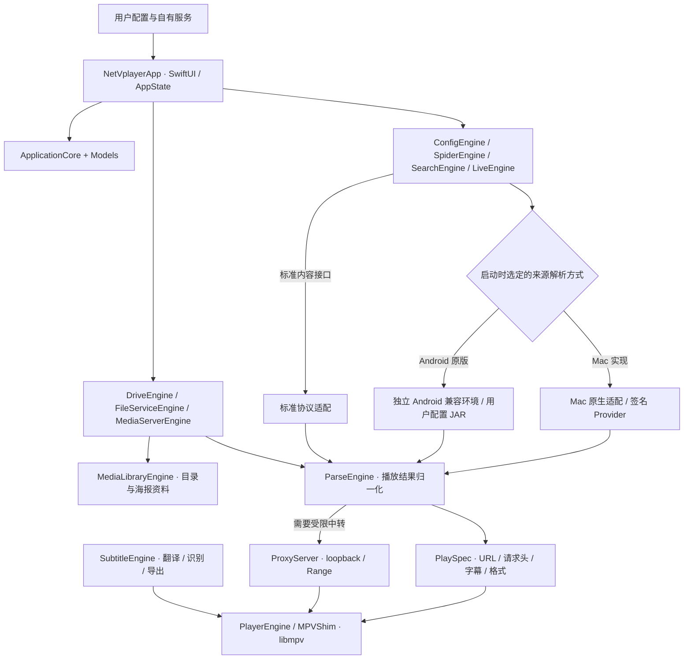
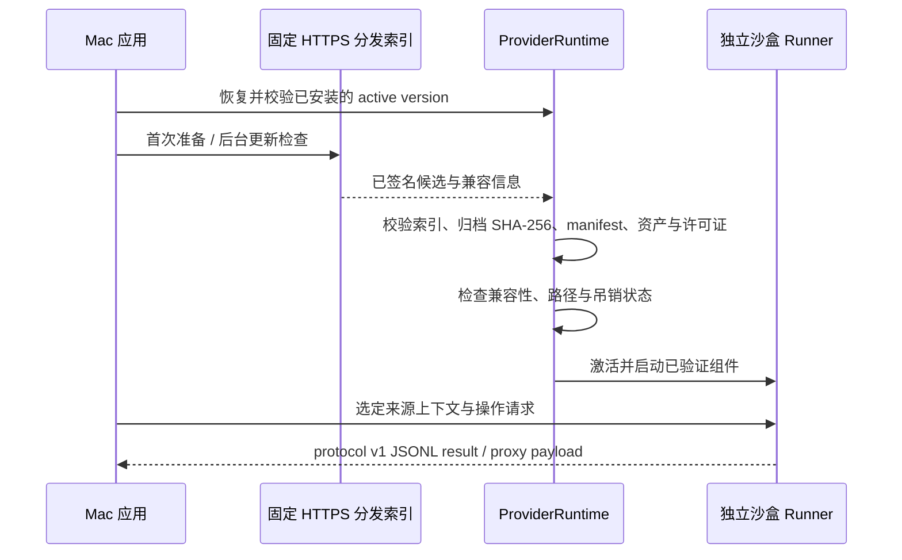

# NetVplayer Architecture

[中文](#中文) · [English](#english) · [使用指南](docs/guide.md) · [Provider SDK](provider-sdk/README.md)

## 中文

### 整体设计

NetVplayer 将原生桌面体验、内容接入、扩展执行和媒体播放分开。SwiftUI 应用负责浏览、搜索、详情、账号入口与窗口；不同内容接口输出稳定模型；播放器只接收统一的 `PlaySpec`，由内嵌 libmpv 完成实际媒体播放。

用户提供自己的配置、云盘、文件位置、媒体服务器与访问权限。公开应用不附带视频源、直播列表、站点业务 Provider、账号或媒体。

图中的两种来源执行路径按用户选择运行，不会在失败后互相回退。本机文件、媒体服务器和标准内容接口独立于这个选择。Android 原版指内容组件的执行环境；界面、窗口和媒体播放器始终属于 Mac 应用。

### 三个发布组件

| 组件 | 维护内容 | 公开范围 |
| --- | --- | --- |
| [NetVplayer](https://github.com/spudhero/NetVplayer) | 原生应用、通用内容集成、SDK／Runner、构建工具、使用文档与官网 | 主程序和通用协议公开，采用 MIT；第三方组件遵循各自许可证 |
| NetVplayer-Providers | 站点业务适配、私有构建与测试、Android 兼容环境构建 | 业务 Provider 实现保持私有；获准公开的通用 Android Java／JNI、兼容层与固定上游对应源码随完整环境发布提供 |
| [NetVplayer-Provider-Distribution](https://github.com/spudhero/NetVplayer-Provider-Distribution) | 签名分发索引、公钥、发行元数据与独立发布包 | 发布包与索引公开；私钥、账号和用户来源 JAR 不属于分发输入 |

应用与扩展使用各自的版本及发布节奏。更新内容适配或 Android 环境时，不必把整个应用重新发布；组件兼容性和验签仍由应用执行。当前通用 Android 源码与复现材料见[完整环境附件](https://github.com/spudhero/NetVplayer-Provider-Distribution/releases/tag/android-original-runtime-v1.2.4-arm64)。

### 应用模块

| 层 | 模块 | 职责 |
| --- | --- | --- |
| 界面与组合 | `NetVplayerApp` | SwiftUI、AppState、内容选择、详情／海报缓存协调、窗口、设置、命令执行和用户可见错误映射 |
| 决策与合同 | `ApplicationCore`, `Models` | 稳定模型、状态、命令与不依赖平台副作用的状态转换 |
| 网络与存储 | `Networking`, `Storage` | 受控请求、本机持久化、缓存、偏好与不含敏感凭据的备份 |
| 配置与内容 | `ConfigEngine`, `SpiderEngine` | 解释用户配置、选择精确绑定的适配器、调用当前执行方式 |
| 搜索与直播 | `SearchEngine`, `LiveEngine` | 有界并发与渐进搜索、直播列表、频道分组和 EPG |
| 云盘与文件 | `DriveEngine`, `FileServiceEngine` | 网盘账号与目录、SMB／WebDAV／AList／OpenList／FTP／SFTP、本机文件及受限流式读取 |
| 媒体服务器 | `MediaServerEngine` | Emby／Jellyfin／Plex／极影视／飞牛影视的账号、目录、详情和播放输入 |
| 媒体库与资料 | `MediaLibraryEngine` | 电影／剧集／混合库、扫描、海报、优先本地资料、TMDB／豆瓣与手动匹配 |
| 扩展协议与生命周期 | `ProviderSDK`, `ProviderRuntime` | Wire／manifest／distribution 合同、签名校验、安装、激活、回滚及沙盒进程 |
| 通用脚本能力 | `QuickJSRuntime`, `NodeBundleRuntime` | 通用脚本执行及受控宿主能力，业务适配由独立组件维护 |
| 解析与数据面 | `ParseEngine`, `ProxyServer` | 播放候选解析、受限本地路由、Range、注册文件及必要的清单／请求中转 |
| 播放与输出 | `PlayerEngine`, `MPVShim`, `NativePIP` | libmpv、视频表面、播放状态、音画输出、设备与窗口能力 |
| 字幕与弹幕 | `SubtitleEngine`, `DanmakuEngine` | 字幕处理、本机翻译／识别／导出，以及默认关闭的手动弹幕入口 |
| 诊断 | `Diagnostics` | 隐私过滤后的错误、崩溃与性能维度；有限恢复过程与终局错误分开处理 |

产品与 target 的准确依赖以 [`NetVplayer/Package.swift`](NetVplayer/Package.swift) 为准；上表按用户能力归纳，不代表所有模块直接互相依赖。

### Mac 与 Android 的独立执行

来源解析偏好在应用启动时固定。在“设置 → 扩展支持 → 来源解析方式”更改后，必须重启才能应用；本轮运行继续使用启动时的选择。

| 路径 | 内容组件如何执行 | 账号与失败行为 |
| --- | --- | --- |
| Mac 实现 | 原生适配或已验证签名 Provider；不准备、不调用 Android 环境 | 原生网盘账号用于该路径与个人目录；不支持时返回明确错误 |
| Android 原版 | 在独立兼容环境执行用户配置引用的原始 JAR；目录、详情和播放解析使用同一路径 | 来源内授权独立保存；失败不会改为 Mac 适配 |

Android 首次准备从独立的 `android/runtime/index.json` 选择兼容的完整签名环境，下载、验签、校验资产并激活。JVM、框架、宿主等作为已构建环境交付，客户端不再分别下载后组装。用户配置引用的来源 JAR 仍单独获取，不包含在应用或完整环境里。旧 `android/index.json` 保留历史兼容用途。

应用中的公开兼容规则是按固定摘要生成的资源。通用环境源码公开并不改变站点业务实现的私有边界。

### Provider 生命周期与信任

- 只接受固定 HTTPS 索引中的签名发行物；索引签名、归档摘要、manifest 和声明资产分别检查。
- 签名 Provider 的运行时、Runner、入口、依赖和许可证在包内声明；每个 Provider 使用独立状态目录和受限 launcher。
- `source_bindings` 精确匹配用户提供的配置，自动安装只激活 `source_policy=user-configured-only` 的包。
- QuickJS 宿主能力由 manifest 声明；开发者自建密钥不受官方应用信任。
- 有效本机组件先恢复，在线检查在后台进行；首次准备未完成或本机包失效时进入修复／重试状态。
- 待升级版本与当前可用版本分别保存，失败的下载或更新不覆盖最后一个已验证的 active version。

### 目录、媒体库与播放数据流

文件服务、云盘目录与媒体服务器共用稳定媒体模型，但保留各自接入方式。文件服务读取用户授权的目录，媒体库层补充本地或在线资料；媒体服务器直接提供服务端已有的目录与资料。账号凭据不会作为媒体标题、文件身份或备份内容传播。

内容层取得详情、播放候选或文件计划，经过网盘与解析处理后整理为 `PlaySpec`。它包含规范化 URL、必要请求头、格式、字幕、DRM 信息和内存态播放计划。播放器不解释外部配置、站点业务或 Provider manifest。

标准 HLS／MP4 在不需要中转时直接交给 libmpv。Provider callback、需要改写的清单、远端 Range 流和注册本机文件才进入受限 `ProxyServer`，主要路由包括 `/proxy`、`/stream`、`/parse`、`/file`、`/cache`、`/health` 与 `/webResource`。代理只绑定 loopback；通用远端代理目标与用户明确授权的文件／NAS 连接分别受各自访问策略约束。

来源要求手动验证时，通过类型化交互返回经过校验的验证页，由用户完成后重新请求同一内容。这类交互不进入 `PlaySpec`，也不由播放器绕过。

### 音画、字幕与桌面体验

音画输出层将素材信息、设备能力与当前实际输出区分。HDR 策略提供跟随系统、临时 HDR 和 SDR 映射；输出恢复和设备变化由播放层管理。素材带 HDR／杜比视界标记，不意味着显示或音频链路获得对应认证。

`SubtitleEngine` 与应用翻译面板负责字幕文件、时间轴、翻译会话、识别与导出；Apple Translation 在 macOS 15+ 的可用分支运行。图片字幕和音频识别有独立输入与权限要求。小窗、章节、字幕、音轨及播放控制由原生界面组合呈现。

目录、详情与海报使用有界缓存及合并请求，列表刷新保留已有内容，异步返回通过 generation 校验后更新。性能缓存清理与账号／网页会话清理是独立操作，避免删除可重建缓存时连带移除配置或登录状态。

### 状态、隐私与开发

配置、账号与授权只在用户明确添加后使用。凭据存于本机；Provider 使用其来源上下文及不透明凭据引用，不直接读取其他 Provider 的状态或应用凭据存储。历史记录使用稳定内容身份，不持久化短效媒体 URL 或敏感请求头。

普通界面通过统一错误映射显示问题与下一步动作；诊断过滤账号、内容名、媒体地址、原始错误正文与完整日志。可恢复故障记录有限过程，恢复耗尽后才形成终局错误。自动诊断可在设置关闭。

Provider 开发与发行见 [SDK](provider-sdk/README.md)、[Runner](provider-runners/README.md)；应用构建见[贡献指南](CONTRIBUTING.md)。功能与用法见[使用指南](docs/guide.md)，具体验收范围留在[按版本发布说明](docs/releases/README.md)。架构描述不等于所有服务或硬件已完成验收。

## English

### System design

NetVplayer separates its native desktop interface, content integrations, extension execution and media playback. SwiftUI and AppState compose browsing, search, details, settings and windows. Content engines normalize results into stable models and a single `PlaySpec`, which the native player passes to embedded libmpv.

Users supply configurations, accounts, files and services. The public app contains no bundled content source, live list, business Provider, account or media. The Chinese diagrams above describe the same component and playback boundaries.

### Independent publication components

| Component | Responsibility |
| --- | --- |
| Public NetVplayer application | Native UI/player, generic content integration, SDK/Runners, build tools, documentation and website |
| Private business Providers | Site-specific implementations, their builds/tests and Android environment construction; approved generic Android Java/JNI, compatibility/build sources and pinned upstream sources are published as complete-runtime attachments |
| Public Provider Distribution | Signed indexes, public keys, release metadata and independent packages; no private signing keys, user accounts or user source JARs |

The app, Providers and Android environments have independent version and update schedules. Compatibility and signature checks remain enforced by the app.

### Execution and playback

Source execution is fixed at startup. Mac mode selects native adapters or verified Providers without preparing Android. Original Android executes the JAR referenced by user configuration in an independent compatibility environment, with the same implementation handling catalog, details and resolution. Changing mode requires restart; errors do not trigger cross-mode fallback. Local files, media servers and standard content APIs are independent of the setting. Both paths use the native Mac interface and player.

Complete Android environments come from `android/runtime/index.json`. The client downloads, verifies and activates the built environment rather than assembling JVM/framework/host inputs separately. Source JARs remain user-configured downloads. The legacy `android/index.json` is retained for historical compatibility.

Cloud drives, file services and media servers preserve distinct integrations while sharing stable media models. `MediaLibraryEngine` handles folder libraries and metadata. `ParseEngine` normalizes resolved media into `PlaySpec`, carrying URLs, scoped headers, format, subtitles and other required playback information. `PlayerEngine` does not interpret business Provider logic or external configuration. Direct streams bypass `ProxyServer` when mediation is unnecessary; registered files, Range streaming, callbacks and required rewrites use restricted loopback routes.

### Module map

`ApplicationCore` / `Models` define decisions and contracts. `Networking` / `Storage` provide requests, persistence and caches. `ConfigEngine` / `SpiderEngine` select integrations; `SearchEngine` / `LiveEngine` handle search, channels and EPG. `DriveEngine`, `FileServiceEngine`, `MediaServerEngine` and `MediaLibraryEngine` implement owned-media access and organization. `ProviderSDK` / `ProviderRuntime` define and enforce extension contracts. `QuickJSRuntime` / `NodeBundleRuntime` expose generic script capabilities. `PlayerEngine` / `MPVShim` / `NativePIP` manage native playback and windows. `SubtitleEngine`, `DanmakuEngine` and `Diagnostics` provide their scoped supporting features. Exact target dependencies are defined in [Package.swift](NetVplayer/Package.swift).

### Trust, state and privacy

The runtime verifies the fixed HTTPS index signature, archive hash, manifest, declared assets, licenses, compatibility and revocation state before activation. Providers use package-local runtimes/Runners, isolated state and a restricted launcher. Source bindings match exactly; automatic installation accepts only user-configured-only packages. Valid local versions are restored before independent online update checks, and failed updates preserve the last active verified version.

Native cloud credentials and Android authorization are separate. Backups exclude passwords, tokens and cookies; playback history stores stable identity rather than transient URLs or sensitive headers. User-driven upstream verification is modeled separately from `PlaySpec`. UI error mapping and diagnostic filtering keep credentials, media names, raw errors and complete logs out of public reports. Automatic Diagnostics can be disabled.

HDR and audio output depend on actual media and devices. Apple subtitle translation is gated to macOS 15+; recognition and external services have independent requirements. These architecture descriptions do not establish complete acceptance for every source, account, NAS or hardware path. See the [user guide](docs/guide.md#english), [Contributing](CONTRIBUTING.md), [SDK](provider-sdk/README.md), [Runners](provider-runners/README.md) and [release notes](docs/releases/README.md).
