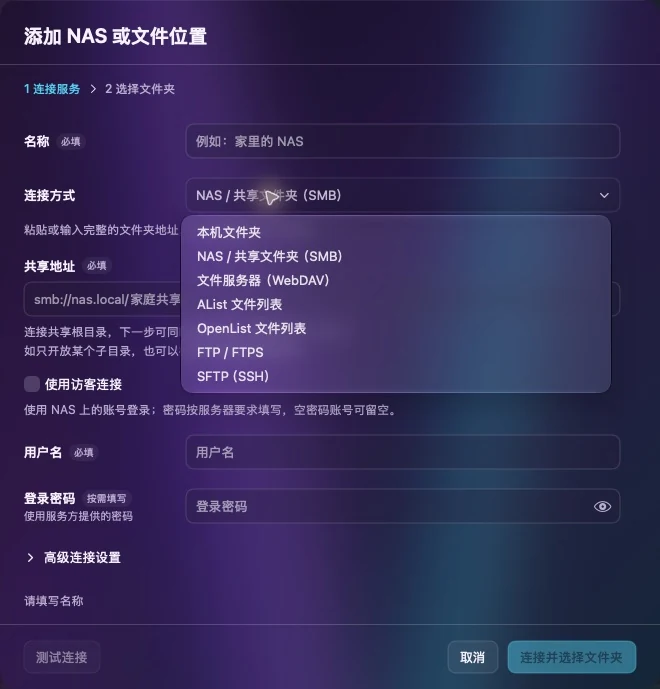
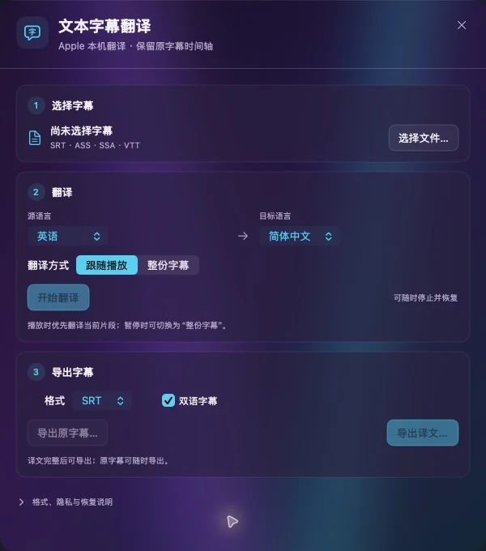
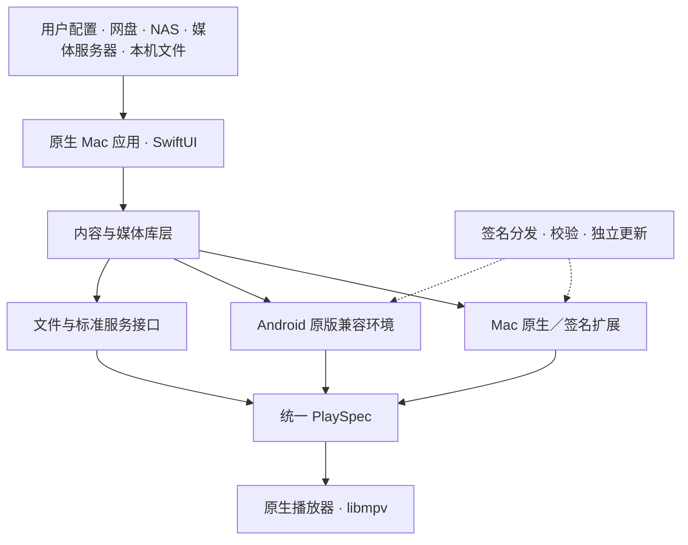

# NetVplayer

<p align="center">
  
</p>

<p align="center">
  <strong>你的内容，你的 Mac，你的播放方式。</strong><br>
  <strong>Your content. Your Mac. Your way to watch.</strong>
</p>

<p align="center">
  <a href="#中文">中文</a> |
  <a href="#english">English</a> |
  <a href="https://spudhero.github.io/NetVplayer/">Website</a> |
  <a href="https://github.com/spudhero/NetVplayer/releases/latest">Download</a> |
  <a href="docs/guide.md">使用指南 / Guide</a> |
  <a href="ARCHITECTURE.md">Architecture</a> |
  <a href="CHANGELOG.md">Release History</a>
</p>


<p align="center">macOS 14+ · Apple Silicon · 简体中文 / English</p>

当前正式版本 / Current release: **NetVplayer 2.0.8 (build 59)** · [下载 / Download](https://github.com/spudhero/NetVplayer/releases/latest) · [发布说明 / Release notes](docs/releases/2.0.8.md)

**NetVplayer 2.0.9 (build 60)**

| 阶段 / Stage | 版本 / Version | 变更 / Changes |
| --- | --- | --- |
| Release candidate | 2.0.9 (build 60) | [发布说明 / Release notes](docs/releases/2.0.9.md) |

## 中文

NetVplayer 是基于 **SwiftUI 与内嵌 libmpv** 的原生 macOS 媒体播放器。把在线点播、电视直播、个人网盘、NAS、本机文件和媒体服务器放进同一套浏览与播放体验：找内容、看详情、选剧集、调字幕，再从历史记录接着看。支持 **Dolby Vision 杜比视界动态映射与 P7 FEL 双层重建、Dolby Atmos 杜比全景声直通**，按显示器、功放或耳机选择音画输出。

内容由你添加。应用不附带视频源、直播列表、账号或媒体；截图中的来源信息已打码，影视海报和名称已模糊，播放器使用自制本地演示视频。

### 从内容到播放，一处完成

| 你想做什么 | NetVplayer 提供什么 |
| --- | --- |
| 浏览与找片 | 分类与筛选、跨已连接来源搜索、影片详情、TMDB 资料、收藏与历史续播 |
| 选择播放内容 | 多线路选集、宫格／列表、正倒序、网盘资源分组；目录提供时显示文件大小 |
| 看直播 | JSON／M3U／TXT 列表、Xtream、频道分组、频道搜索、节目单与线路切换 |
| 打开个人网盘 | 夸克、UC、阿里云盘、百度网盘、115 的个人目录，多选文件夹加入媒体库 |
| 连接文件服务 | SMB、WebDAV、AList、OpenList、FTP／FTPS、SFTP，以及本机文件夹和直接打开文件 |
| 连接媒体服务器 | Emby、Jellyfin、Plex、极影视、飞牛影视；浏览服务端媒体并进入原生播放 |
| 整理媒体库 | 电影、剧集与混合海报墙；本地资料优先，支持 TMDB、豆瓣及手动匹配 |
| 调整观看体验 | 主副字幕、音轨、倍速、比例、章节、片头片尾、小窗置顶；HDR 策略、音频设备与对白清晰度 |
| 享受杜比音画 | 杜比视界 P5／P8 动态映射、P7 FEL 双层重建；DD+ JOC／TrueHD Atmos 直通，实验性 TrueHD 对象渲染 |
| 处理字幕 | 文本字幕本机翻译、双语字幕及导出，图片字幕／音频识别入口，在线字幕搜索 |
| 按自己的习惯使用 | 14 种主题、设置搜索、配置备份、应用内更新与脱敏问题反馈 |

| 详情、线路与资源分组 | 原生播放器与完整控制 |
| :---: | :---: |
|  |  |

### 杜比视界与杜比全景声

从显示器到家庭影院，也照顾耳机观看。NetVplayer 支持读取杜比视界逐帧动态元数据进行画面重建；连接兼容设备时，可将杜比全景声交给功放或回音壁解码。

| 能力 | 实现与输出 |
| --- | --- |
| **Dolby Vision P5／P8** | 读取 RPU 动态元数据，进行色彩重建与动态映射；按设备输出 HDR 或映射到 SDR |
| **Dolby Vision P7 FEL** | 支持 BL＋EL 双层解码与 FEL 重建，结合动态元数据呈现画面 |
| **Dolby Atmos：DD+ JOC** | 原生压缩音频输出，在兼容 HDMI／DisplayPort 链路保留 JOC 对象信息供接收端解码 |
| **Dolby Atmos：TrueHD** | 支持通过 MAT 传输 TrueHD Atmos 至兼容功放／回音壁，保留片源无损音频与对象信息 |
| **TrueHD 对象渲染（实验）** | 对象解码后输出 7.1.4 PCM，或使用耳机 HRTF 空间渲染；兼容耳机可开启头部追踪 |

在“**设置 → 播放偏好 → 色彩与视频输出**”选择跟随系统、临时 HDR 或 SDR 映射。Atmos 在“**音频输出与设备 → 音频直通**”选择默认“自动（保留无损音质）”或“开启（优先直通）”；保留原速并关闭对白增强等音频处理，直通时用功放调节音量。

7.1.4 PCM 需要实际配置了对应扬声器位置的 12 声道设备；耳机头部追踪需要兼容设备与运动权限，没有姿态数据时使用固定空间渲染。TrueHD 对象模式位于“高级设置 → 实验功能”，与 Atmos 原码直通分别选择。常规杜比视界输出可显示“Dolby Vision · HDR 映射／SDR 映射”；另有默认关闭的“系统杜比视界呈现”实验功能（macOS 15+），电视是否收到 DV 仍以接收端为准。完整步骤与模式区别见[杜比音画用法](docs/guide.md#杜比视界与杜比全景声)。

### 你的网盘、NAS 和媒体库

文件服务与媒体服务器分别接入：前者直接浏览文件夹，后者使用服务器已有的媒体资料和目录。连接 NAS 后，可以一次选择多个文件夹，分别整理电影与剧集；个人网盘目录也能进入海报媒体库。

| 个人网盘目录 | NAS 与文件连接 |
| :---: | :---: |
|  |  |

### 音画与字幕，按当前设备调整

播放器提供字幕与音轨切换、主副字幕、进度跳转、倍速、画面比例、章节和小窗置顶。播放偏好中可选择“跟随系统”“临时 HDR”或“SDR 映射”，查看实际输出，并调整音频设备与对白清晰度。

文本字幕翻译可跟随播放或处理整份字幕，并导出译文或双语字幕。**Apple 本机翻译需要 macOS 15+ 及可用的语言资源**；图片字幕识别、音频识别和在线搜索有各自的系统、权限或服务要求。弹幕默认关闭，按需手动开启。

| 文本字幕翻译与导出 | 色彩与视频输出 |
| :---: | :---: |
|  |  |

播放中可查看当前实际画面与声音输出，帮助确认 HDR 映射、Atmos 直通或 PCM 渲染。设备兼容性、服务登录和原片持续播放条件见[使用指南](docs/guide.md#使用条件与限制)。

### 两种来源解析方式，同一套 Mac 体验

在“**设置 → 扩展支持 → 来源解析方式**”选择：

- **Mac 实现**：使用 Mac 原生适配或签名扩展，不准备 Android 环境。
- **Android 原版**：在独立兼容环境中执行用户配置引用的原始 JAR；目录、详情和播放解析沿用同一实现。首次使用下载、验证并激活完整签名环境，来源 JAR 由用户配置提供。

更改后重启应用生效，两种方式不自动互相回退。本机文件、媒体服务器和标准内容接口不受此选择影响。**Android 原版是内容解析方式，应用界面与媒体播放仍为原生 macOS。** 原生网盘账号与 Android 来源内授权分别保存。


### 安装与第一次使用

1. 从[最新 GitHub Release](https://github.com/spudhero/NetVplayer/releases/latest)下载名称包含 `macos-arm64.zip` 的安装包。
2. 解压，把 `NetVplayer.app` 拖入“应用程序”。当前提供 **Apple Silicon / macOS 14+** 构建。
3. 当前社区包使用 ad-hoc 签名。首次打开如被拦截，确认来自本项目后，在“系统设置 → 隐私与安全性”选择“仍要打开”；系统允许时也可使用 Finder 右键“打开”。
4. 打开“设置 → 扩展支持”，等待所需扩展就绪。首次安装和扩展更新需要能访问 GitHub。
5. 在“设置 → 内容来源”添加自己的内容。没有添加内容时，空白首页是正常状态。

| 内容在什么地方 | 从哪里开始 |
| --- | --- |
| 影视配置／直播列表 | 内容来源 → 在线内容 → 填入自己的链接 → 加载影视／加载直播 |
| Xtream 服务 | 内容来源 → 在线内容 → 影视与直播账号 → 验证并连接 |
| Emby／Jellyfin／Plex／极影视／飞牛影视 | 内容来源 → 在线内容 → 媒体服务器 → 选择类型并登录 |
| 个人网盘文件夹 | 内容来源 → 网盘账号 → 登录 → 添加网盘目录 → 选择文件夹 |
| NAS／文件服务器／本机文件夹 | 内容来源 → NAS / 本地 → 添加连接 → 测试连接 → 连接并选择文件夹 |
| 单个本机视频 | 菜单栏 → 文件 → 打开文件，或把视频拖入应用；如出现“待打开的文件”，选择其中的文件 |

配置成功后回到点播首页，从来源菜单选择已添加的入口。打开详情，选择线路与剧集；历史记录可继续上次播放。找不到设置时，在设置页顶部输入关键词，点击结果直接定位。

完整图文说明：[使用指南](docs/guide.md) · [官网功能介绍](https://spudhero.github.io/NetVplayer/)。版本号旁会提示应用更新，确认后后台下载与校验，正常退出后安装；具体变更见 [CHANGELOG](CHANGELOG.md) 与[发布说明](docs/releases/README.md)。

### 新版架构

主程序、内容扩展和签名分发独立维护。原生界面负责浏览与交互，内容层把不同服务的结果整理为统一播放输入，再交给 libmpv。



图中的 Mac／Android 是主动选择的独立路径。公开应用和 [Provider SDK](provider-sdk/README.md) 位于 [NetVplayer](https://github.com/spudhero/NetVplayer)，站点业务 Provider 源码保持私有，签名包与索引由 [Provider Distribution](https://github.com/spudhero/NetVplayer-Provider-Distribution/releases) 提供。通用 Android Java／JNI 兼容层、固定上游对应源码和构建说明随[完整环境发布附件](https://github.com/spudhero/NetVplayer-Provider-Distribution/releases/tag/android-original-runtime-v1.2.4-arm64)公开。更多模块、数据流与信任边界见 [ARCHITECTURE](ARCHITECTURE.md)。

### 项目背景与开发

FongMi/TV、OK影视、影视仓、TVBox 等工具主要服务 Android 生态。我一直没有找到符合自己使用习惯的 macOS 版本，于是从 SwiftUI 与 libmpv 开始，写了 NetVplayer。感谢 [FongMi/TV](https://github.com/FongMi/TV) 等开源实践提供的兼容性参考；本项目独立实现，与这些项目没有隶属或官方合作关系。

按[贡献指南](CONTRIBUTING.md)准备 Xcode、Homebrew libmpv 与所需依赖后，在公开仓库根目录执行：

```bash
swift build --package-path NetVplayer
swift test --package-path NetVplayer --disable-sandbox --no-parallel
```

配置与账号保存在本机，导出备份不包含密码、Token 或 Cookie。正式应用提供 TMDB 项目凭据，普通用户无需填写令牌。可在“设置 → 问题反馈”生成脱敏信息或关闭自动诊断。

[Provider SDK](provider-sdk/README.md) · [Runner](provider-runners/README.md) · [打包配置](TMDB_SETUP.md) · [安全说明](SECURITY.md) · [MIT License](LICENSE)（第三方组件适用各自许可证）。

---

## English

NetVplayer is a **native macOS media player built with SwiftUI and embedded libmpv**. Browse on-demand video, watch live channels, open personal cloud folders, connect your NAS or media server, and play local files in one desktop experience. It supports **Dolby Vision dynamic mapping and P7 FEL reconstruction, plus Dolby Atmos passthrough**, with output choices for displays, home theaters and headphones. It runs on **macOS 14+ / Apple Silicon**, in Simplified Chinese and English.

You supply the content. The app includes no source configuration, channel list, account, or media. Screenshots mask private source details and blur artwork and media names; the player shows a self-created local demo.

### Your content, in one place

| Experience | Capabilities |
| --- | --- |
| Browse and discover | Categories, filters, search across connected sources, details, TMDB metadata, favorites and resume history |
| Routes and episodes | Multiple routes, grid/list views, sorting, grouped cloud resources, and file sizes when supplied by the directory |
| Live TV | JSON/M3U/TXT lists, Xtream, channel groups, search, programme guides and route selection |
| Personal cloud folders | Quark, UC, Aliyun, Baidu and 115; select folders for the poster library |
| File services | SMB, WebDAV, AList, OpenList, FTP/FTPS, SFTP and local folders, plus direct file opening |
| Media servers | Emby, Jellyfin, Plex, Zspace Media and FnOS Media |
| Poster libraries | Movies, TV shows and mixed libraries; local metadata, TMDB, Douban and manual matching |
| Playback | Main/secondary subtitles, audio tracks, speed, aspect ratio, chapters, intro/outro skip and a floating player |
| Picture, audio and subtitles | HDR policy, SDR mapping, actual output status, audio devices, dialogue enhancement, local subtitle translation and bilingual export |
| Dolby picture and sound | Dolby Vision P5/P8 mapping and P7 FEL reconstruction; DD+ JOC/TrueHD Atmos passthrough, experimental TrueHD object rendering |
| Desktop experience | 14 themes, settings search, configuration backup, in-app updates and redacted problem reports |

The real-app screenshots above show details, playback, cloud folders, file connections, subtitle translation, video output and extension management. [The illustrated guide](docs/guide.md#english) explains the entry points and steps.

### Dolby Vision and Dolby Atmos

**Dolby Vision P5/P8** uses per-frame RPU metadata for reconstruction and dynamic mapping to HDR or SDR. **P7 FEL** supports dual-layer BL+EL decoding and FEL reconstruction. Choose Follow System, Temporary HDR or SDR Mapping under Playback Preferences → Color & Video Output.

**DD+ JOC Atmos** uses native compressed audio output and preserves JOC information on compatible HDMI/DisplayPort routes. **TrueHD Atmos** can be transported over MAT to compatible receivers or soundbars. Under Audio Output & Devices → Audio Passthrough, use the default automatic lossless mode or prefer passthrough. Keep playback at normal speed with audio processing disabled; the receiver controls volume during passthrough.

**Experimental TrueHD object rendering** offers 7.1.4 PCM, fixed headphone HRTF and compatible headphone head tracking. A correctly configured 12-channel speaker layout is required for 7.1.4; tracking requires compatible headphones and motion permission, with fixed rendering when pose data is unavailable. These PCM modes are separate from receiver Atmos passthrough.

The player reports actual output, including Dolby Vision HDR/SDR mapping. Experimental System Dolby Vision Presentation is also available on macOS 15+ with HDR, disabled by default; receiver-side DV recognition still requires device confirmation. See [Dolby setup and output modes](docs/guide.md#dolby-vision-and-dolby-atmos).

### Getting started

1. Download the versioned `macos-arm64.zip` from the [latest Release](https://github.com/spudhero/NetVplayer/releases/latest), extract it, and move `NetVplayer.app` to Applications.
2. Community builds use ad-hoc signing. If macOS blocks first launch, confirm the download source and use System Settings → Privacy & Security → Open Anyway; Finder → Open is available on supported system versions.
3. Wait for Settings → Verified Extensions to finish preparation. First installation and updates require access to GitHub.
4. Under Settings → Content Sources, add your own configuration/channel list, Xtream or media-server account, personal cloud folder, or NAS/local connection. For individual local videos, use File → Open or drag them into the app, then select any pending file entry.
5. Select the added source on the home screen, open details, choose a route and episode, and adjust playback controls. Resume from History later.

For file services, test the connection and select one or more folders. For personal cloud folders, authorize the account first. Media servers use their own server-side catalog and metadata. Official builds supply the TMDB application credential.

### Mac and original Android execution

Settings → Verified Extensions → Source Execution selects **Mac implementation** or **Original Android**. Restart after changing it. Mac mode uses native adapters or signed extensions without preparing Android. Original Android executes the JAR referenced by your configuration in an independent compatibility environment, with one selected implementation handling catalog, details and playback resolution.

The app verifies and activates a complete signed Android environment on first use. Content JARs come from user configuration. There is no automatic cross-mode fallback; local files, media servers and standard content APIs are independent of this setting. **The interface and media player remain native macOS in both modes.** Native cloud credentials and Android source authorization are stored separately.

### Architecture and development

The public app, private business Providers and signed distribution are maintained as separate components. Content engines normalize source, cloud, file and server results into a single `PlaySpec`; the native player passes it to libmpv. Extensions and complete Android environments update independently of the app. See the [architecture diagrams](ARCHITECTURE.md), [Provider SDK](provider-sdk/README.md) and [Runners](provider-runners/README.md).

The application and SDK are public. Business Provider sources remain private. Generic Android Java/JNI compatibility and build sources, pinned upstream sources and licenses are available as [complete-runtime release attachments](https://github.com/spudhero/NetVplayer-Provider-Distribution/releases/tag/android-original-runtime-v1.2.4-arm64).

Apple local translation requires **macOS 15+** and available language resources. OCR, speech recognition, online subtitles, HDR and audio output depend on system support, permissions, content and hardware. Service integrations are not a guarantee that every account, NAS or long playback session has passed acceptance. Read the [usage conditions](docs/guide.md#conditions-and-limits).

Prepare dependencies using [Contributing](CONTRIBUTING.md), then run the build/test commands above from the public repository root. Configurations and credentials stay on your Mac; backups exclude passwords, tokens and cookies. Automatic Diagnostics can be disabled under Settings → Problem Report.

Inspired by the compatibility work of [FongMi/TV](https://github.com/FongMi/TV) and other Android projects, NetVplayer is independently implemented with no official affiliation. [MIT License](LICENSE); third-party components retain their own licenses. Release changes belong in the [CHANGELOG](CHANGELOG.md) and [versioned notes](docs/releases/README.md).
