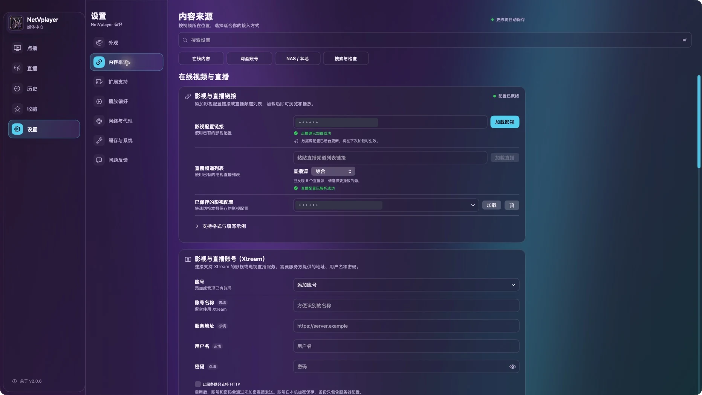
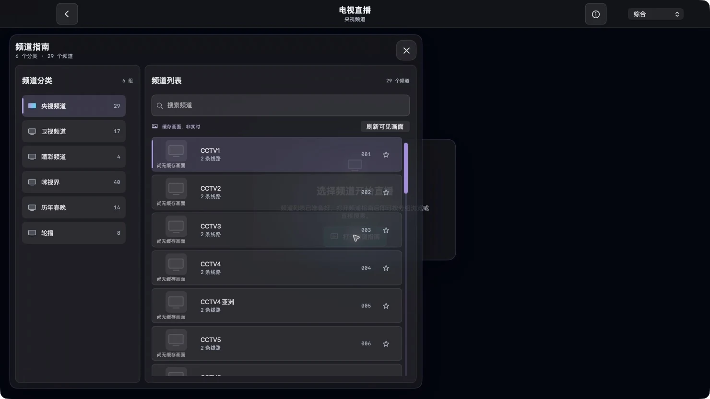
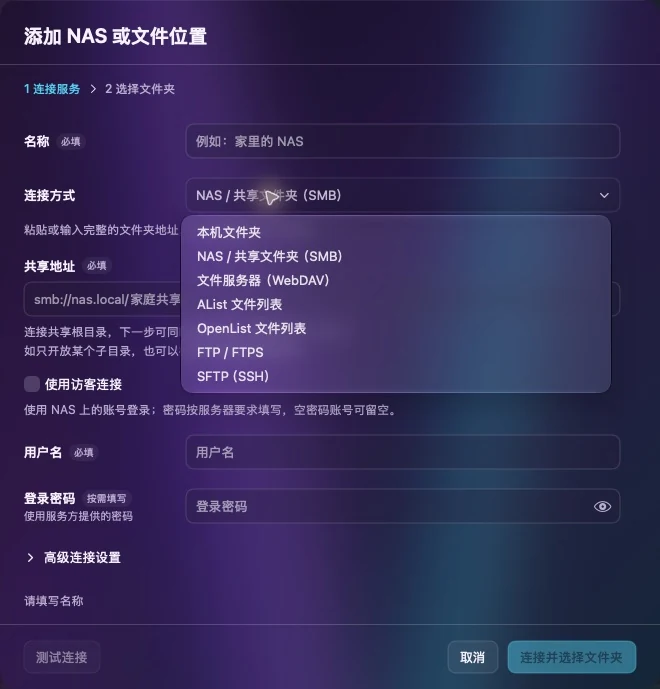
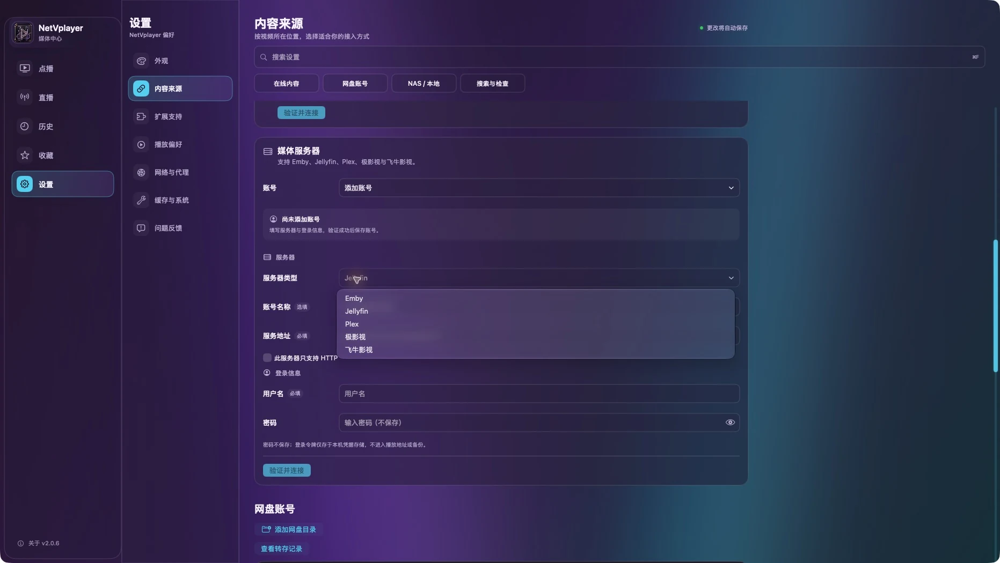
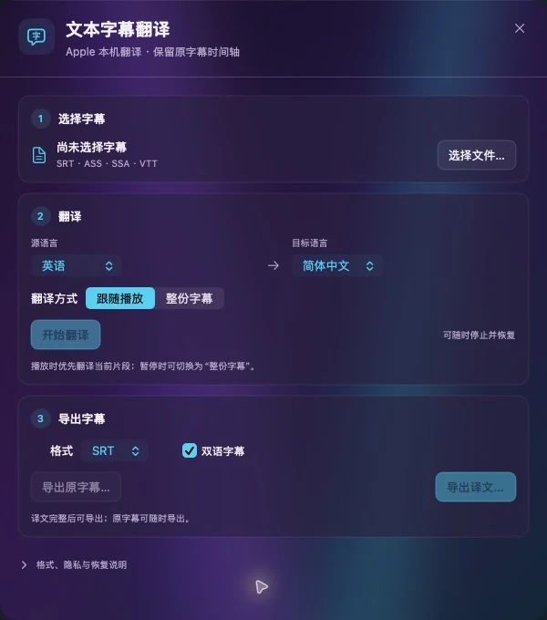
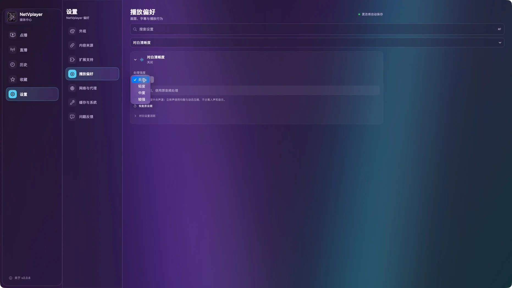
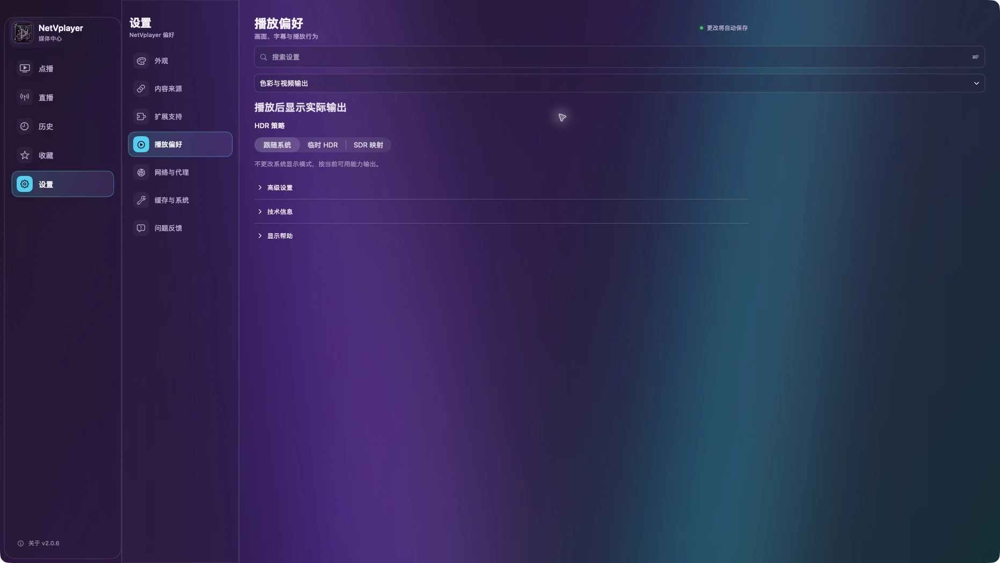
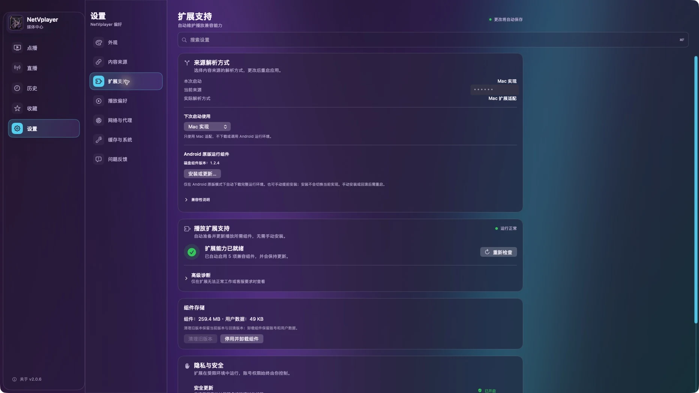

# NetVplayer 使用指南 / User Guide

[中文](#中文) · [English](#english) · [返回介绍](../README.md) · [官网](https://spudhero.github.io/NetVplayer/) · [架构](../ARCHITECTURE.md)

## 中文

### 先安装，再添加自己的内容

1. 下载[最新正式版](https://github.com/spudhero/NetVplayer/releases/latest)的 `macos-arm64.zip`，解压并将应用移入“应用程序”。需要 Apple Silicon 和 macOS 14 或更新系统。
2. 社区包使用 ad-hoc 签名。首次被系统阻止时，先核对下载来源，再按系统提示到“隐私与安全性”选择“仍要打开”；部分系统也支持 Finder 右键“打开”。
3. 进入“设置 → 扩展支持”。首次安装和扩展更新需要能连接 GitHub；正常情况下自动完成，失败时选择“重新检查”。已安装且校验有效的组件可在离线时继续使用，内容服务本身仍可能需要联网。
4. 打开“设置 → 内容来源”，选择下文对应的入口。应用不附带内容，首次首页为空是正常状态。

本指南截图取自实际安装的 2.0.6。来源信息在图片中直接打码，海报与影视名称模糊处理；播放器显示自制本地演示视频。空白连接表单用于说明操作入口，不表示已连接真实账号或 NAS。

### 在线点播、直播与搜索

打开“设置 → 内容来源 → 在线内容”（页面标题为“在线视频与直播”）。

- 将自己的影视配置填入“影视配置链接”，点击“加载影视”。返回点播首页，从左上来源菜单切换已配置的来源。
- 将 JSON、M3U 或 TXT 直播列表填入“直播频道列表”，点击“加载直播”。配置包含多个直播源时，可在“直播源”菜单中选择。
- 使用 Xtream 时，在“影视与直播账号（Xtream）”填写服务方提供的地址、用户名和密码，选择“验证并连接”。
- 点击首页右上角搜索，输入关键词；也可粘贴支持的网盘分享文本。搜索范围在“内容来源 → 搜索与检查”调整，只搜索你已经配置的来源。

详情页可切换原详情与 TMDB 资料，选择播放线路、资源组和剧集。右上方切换宫格／列表或正倒序。文件大小仅在来源目录已提供时显示；没有大小的条目留空。出现“需授权”时，按对应网盘提示完成自己的登录。

来源提供资源目录时，点击影片会先进入该来源的资源列表，再选择具体资源和剧集。片单或搜索卡片则进入跨来源搜索。海报、目录加载成功仅说明资料可读，播放还需要对应媒体和账号可用。

直播播放器的“频道指南”可按分组浏览或搜索频道，“节目单”查看可用 EPG，播放期间可切换线路、调整音量和进入小窗。指南中的预览是缓存画面，使用“刷新可见画面”更新；没有缓存时仍可选择频道。节目数据取决于列表或服务提供的 EPG。

### 个人网盘目录

1. 在“内容来源 → 网盘账号”选择所需服务并登录。**个人目录支持夸克、UC、阿里云盘、百度网盘和 115**。
2. 点击“添加网盘目录”，选择服务。若提示未登录，先完成该网盘的授权。
3. 进入文件夹选择页，选择一个或多个目录加入媒体库。之后从首页已添加的媒体入口浏览。
4. 原生网盘账号用于 Mac 实现与个人目录；**Android 原版需在视频源内按提示扫码，其授权独立保存**。

“登录网盘”页面还有其他受支持账号入口，但账号可登录不等于该服务支持个人目录。本指南列出的五种服务才是当前“添加网盘目录”范围。分享目录是否可读、原片是否可播，还受账号权限、验证状态、限速和服务规则影响。

### NAS、文件服务器与本机文件

在“内容来源 → NAS / 本地”（页面标题为“NAS 与本地媒体”）点击“添加连接”：

1. 填写便于识别的名称，选择本机文件夹、SMB、WebDAV、AList、OpenList、FTP／FTPS 或 SFTP。
2. 填写地址以及服务需要的账号信息。本机文件夹通过系统选择器授权访问；远程服务使用你自己的连接信息。
3. 选择“测试连接”。通过后点击“连接并选择文件夹”，选择一个或多个目录。
4. 连接只需建立一次，电影、剧集等文件夹可分别管理。按目录用途设置媒体库类型和资料来源，从首页进入浏览。

只看单个本机视频时，使用“文件 → 打开文件…”或将视频拖入应用。如右上出现“待打开的文件”，展开并选择文件开始播放，不必先建媒体库。

### Emby、Jellyfin、Plex、极影视与飞牛影视

这些服务使用已有的服务器媒体库。进入“内容来源 → 在线内容”，向下找到“媒体服务器”：选择类型，填写服务地址和登录信息，点击“验证并连接”。成功后从首页来源菜单选择对应服务器，再浏览电影、剧集和详情。

媒体服务器与 SMB／WebDAV 是不同接入方式：前者由服务端组织媒体资料，后者让应用读取文件目录并整理媒体库。极影视／飞牛影视等服务的真实 NAS 和不同版本兼容性尚未全面验收，连接入口的存在不保证每台设备可用。

### 海报、影片资料与媒体库

为电影、剧集或混合目录创建媒体库后，可补充海报、简介、评分并手动匹配资料。“内容来源 → NAS / 本地 → 海报与影片资料”设置新建库的默认资料来源，已有库在编辑时分别调整。

“自动选择”优先使用视频旁的本地资料，再尝试可用的 TMDB 和豆瓣；只用本地资料也能整理与播放。正式包提供项目 TMDB 凭据，普通用户无需填写令牌。元数据服务仅补充影片资料，不提供视频内容。

### 播放、音画与字幕

播放器底部集中提供选集、前后跳转、片头片尾、字幕、音轨、比例、倍速、音量、设置、小窗和全屏。章节信息取决于媒体；历史记录保存续播位置。

点击底栏音量，拖动淡紫色的竖向滑块，也可用滚轮或方向键调节。双击底栏音量可切换静音，静音时喇叭图标会显示斜线。播放带章节的媒体时，悬停时间轴的章节节点可查看缩略图，点击节点可跳到该章。网盘片源会先保证当前播放缓冲，再在后台读取预览。

| 调整项 | 操作位置与说明 |
| --- | --- |
| 字幕和音轨 | 播放器 → 字幕／音轨，选择主字幕、副字幕或所需音轨 |
| 字幕样式 | 设置 → 播放偏好 → 播放行为 → 字幕，调整字体、大小、位置、描边；图片字幕使用缩放 |
| 文本字幕翻译 | 播放器 → 字幕 → 文本字幕翻译，选择 SRT／ASS／SSA／VTT 文件和语言，可跟随播放或翻译整份字幕 |
| 双语与导出 | 翻译面板 → 导出字幕，选择格式及“双语字幕”；译文完整后可导出，原字幕可随时导出 |
| 图片字幕／音频识别 | 播放器 → 字幕 → 图片字幕／音频识别，按面板提示选择输入并准备所需权限或资源 |
| 在线字幕 | 播放器 → 字幕 → 在线搜索，需要可用的外部字幕服务 |
| HDR 与 SDR | 设置 → 播放偏好 → 色彩与视频输出，选择跟随系统、临时 HDR 或 SDR 映射；播放器中可查看实际输出 |
| 音频设备 | 设置 → 播放偏好 → 音频输出与设备，按当前设备选择输出策略 |
| 对白清晰度 | 设置 → 播放偏好 → 对白清晰度，选择关闭、轻度、中度或较强；“恢复原音频”撤销处理 |
| 弹幕 | 设置 → 播放偏好 → 播放行为 → 弹幕手动入口；默认关闭，开启后在播放器中手动搜索 |

| 文本字幕翻译 | 对白清晰度 |
| :---: | :---: |
|  |  |

Apple 本机翻译需要 **macOS 15+** 和可用语言资源；macOS 14 可使用原字幕及其导出功能。对白增强使用音频处理，并不分离人声与音乐。临时 HDR、HDR／杜比视界呈现及音频格式的实际输出都依赖当前素材、系统、显示器和音频链路；以实际输出状态为准。

### 杜比视界与杜比全景声

#### 杜比视界：动态映射与双层重建

支持 **Dolby Vision P5／P8 的逐帧 RPU 动态映射**，以及 **P7 的 BL＋EL 双层解码与 FEL 重建**。根据显示器能力与所选策略，将重建画面输出为 HDR 或映射到 SDR；SDR 屏幕也可观看经过动态映射的画面。

1. 打开自己的杜比视界媒体，选择对应视频与音轨。
2. 在“设置 → 播放偏好 → 色彩与视频输出”选择“跟随系统”“临时 HDR”或“SDR 映射”。跟随系统使用当前显示模式；临时 HDR 在支持的设备上尝试切换，播放结束恢复。
3. 在播放器的“当前实际画面”查看结果。“Dolby Vision · HDR 映射／SDR 映射”表示已使用当前帧的杜比视界重建结果；仅在片名或素材信息中看到 DV，不等于电视已进入 Dolby Vision 模式。

“高级设置 → 实验功能”另有默认关闭的“**系统杜比视界呈现**”，需要 macOS 15+、可用运行库与 HDR 输出。常规路径将重建画面交给系统呈现；其中“保留兼容片源的动态元数据”可尝试部分 P8.1／P8.4 原始 RPU 路径，字幕、画面变换或不兼容时使用重建画面。系统提交状态会提示“待设备确认”，电视实际接收格式仍需在接收端检查；它不等于 HDMI 原始 DV 码流直通。

#### 杜比全景声：交给家庭影院解码

支持 **DD+／E-AC-3 JOC Atmos** 与 **TrueHD Atmos** 原码输出：兼容链路上保留 DD+ 的 JOC 对象信息，TrueHD Atmos 则通过 MAT 传输至功放或回音壁。设备能力、电视转发与 eARC 配置会影响最终可用格式。

1. 连接支持目标格式的 HDMI／DisplayPort 音频设备；经过电视转发时，确认电视和 eARC 链路也支持该格式。在媒体中选择实际带 Atmos 的音轨。
2. 打开“设置 → 播放偏好 → 音频输出与设备 → 音频直通”。默认“**自动（保留无损音质）**”按片源和设备选择；也可选“**开启（优先直通）**”。播放器音量面板提供相同选择。
3. 保持 **1× 原速**，关闭对白增强与音频滤镜。直通时使用功放／回音壁调节音量；需要应用内音量或处理时，可选“关闭（PCM）”。恢复原速并关闭处理后，会重新尝试原生音频输出。
4. 查看“当前实际声音”和“技术信息”，再核对功放／回音壁的 Atmos 显示。设备不支持目标格式时使用可用的 PCM 输出；普通多声道 PCM 本身不代表 Atmos 对象输出。

#### TrueHD 对象渲染：扬声器与耳机（实验功能）

在“**音频输出与设备 → 高级设置 → 实验功能 → TrueHD 对象渲染**”选择。默认“自动（使用原生输出）”保留原生音频路径；下列模式使用 TrueHD 对象解码与 PCM 渲染。

| 模式 | 用法与设备条件 |
| --- | --- |
| **7.1.4 PCM** | 向已正确配置 7.1.4 扬声器位置的 12 声道设备输出，包含四个高度声道；仅有 8 声道 HDMI PCM 或“12 声道”计数还不够 |
| **耳机空间音频（固定）** | 将 TrueHD 对象音频经 HRTF 渲染为双声道耳机输出；请佩戴耳机 |
| **耳机空间音频（头部追踪）** | 根据兼容耳机的姿态调整空间渲染，需要运动权限；没有有效姿态数据时使用固定空间渲染 |

这些模式可使用应用内音量与对白增强，属于本机 PCM 渲染。DD+ JOC 的支持路径是前述压缩音频输出；此处的对象解码专用于 TrueHD。它们与向功放发送原片 TrueHD Atmos 的 MAT 直通分别工作，不把普通 PCM 重新编码成 Atmos。当前实验模式已有软件链路验证，实体 7.1.4 布局与耳机追踪仍需按具体设备确认。

### 选择 Mac 实现或 Android 原版

1. 打开“设置 → 扩展支持 → 来源解析方式”。
2. 在“下次启动使用”选择 Mac 实现或 Android 原版，按提示重启应用。
3. Android 原版首次加载配置时自动下载并校验完整签名环境。保持 GitHub 可访问，完成后重新选择内容。
4. 当前页面会显示“本次启动”和“实际解析方式”；切换不会在正在运行的会话里立即生效。

Mac 模式不下载或调用 Android 环境；Android 模式在兼容环境中执行用户配置的原始 JAR。两者独立运行，不在失败后自动改用另一种实现。本机文件、媒体服务器和标准内容接口不受此选项影响。应用界面与实际媒体播放始终使用原生 Mac 实现。

所需扩展通常自动维护。可用的本机版本与在线更新状态分别显示；首次准备失败可“重新检查”。手动安装和回滚属于高级操作，需按提示重启，详见[扩展发布](https://github.com/spudhero/NetVplayer-Provider-Distribution/releases)。

### 个性化、更新与反馈

- “设置 → 外观”选择 14 种主题之一，选择自动保存。
- 在设置顶部输入“字幕”“HDR”等关键词，点击结果直接定位。
- 应用版本旁出现更新提示时，确认后后台下载与校验，正常退出后安装。
- 配置备份不包含密码、Token 或 Cookie；恢复配置后可能需要重新登录。
- “设置 → 问题反馈”可生成脱敏信息和关闭自动诊断。反馈时说明应用版本、使用的解析方式、复现步骤和错误提示，避免上传未打码的链接或账号信息。

### 使用条件与限制

- 需要自己有权访问的配置、服务与媒体。配置加载成功或目录展开不代表每一条线路都可播放。
- 网盘登录、个人目录、原片持续播放、不同 NAS／服务端版本、全部来源和 macOS 14 实机的完整验收仍有未覆盖范围。部分服务可能返回空结果、验证要求、限速或媒体请求拒绝。
- 杜比视界动态映射／FEL 重建与 Atmos 直通按上文的片源和设备条件工作；实际播放状态与接收端格式分别确认。系统 DV 呈现及 TrueHD 对象渲染为实验功能。
- 本机翻译、图片／音频识别、在线字幕和弹幕需要相应的系统能力、权限、语言资源或外部服务；没有对应数据时不会凭空生成字幕或节目内容。
- 图文介绍说明当前功能与用法；具体版本修复和验证范围见[发布说明](releases/README.md)。

---

## English

### Install and add content

Download the versioned `macos-arm64.zip` from the [latest Release](https://github.com/spudhero/NetVplayer/releases/latest), extract it and move the app to Applications. Apple Silicon and macOS 14+ are required. Community builds use ad-hoc signing; verify the download source and follow macOS Privacy & Security → Open Anyway if blocked.

Wait for Settings → Verified Extensions to prepare the required components. First installation and updates need GitHub access; use Check Again if preparation fails. An empty first-run home screen is expected until you add content.

The screenshots above are real captures from installed 2.0.6. Private source values are masked in the image files, artwork and media names are blurred, and the player displays a self-created local demo. Empty forms document the interface, not successful real-account connections.

### Connect your content

| Content | Steps |
| --- | --- |
| Video configuration or live list | Settings → Content Sources → Online Content; load your configuration or JSON/M3U/TXT list, then select the source on Home |
| Xtream | Online Content → video/live accounts; enter the service address and credentials, then Verify and Connect |
| Personal cloud folders | Cloud Drive Accounts → authorize Quark, UC, Aliyun, Baidu or 115 → Add Cloud Folder → choose one or more folders |
| NAS / file service | NAS / Local → Add Connection → choose SMB, WebDAV, AList, OpenList, FTP/FTPS or SFTP → Test → Connect and Select Folders |
| Local folder or individual file | Add a local folder through the system picker, or use File → Open / drag a video into the app; select a pending file entry if shown |
| Media server | Online Content → Media Servers → choose Emby, Jellyfin, Plex, Zspace Media or FnOS Media, supply your server and sign in |

File services expose folders for the app to browse and organize. Media servers supply their own catalogs and metadata. Personal folder support currently covers the five services listed above; a separate account-login entry does not imply personal-folder support.

Poster libraries support movie, TV and mixed folders. Set metadata defaults under NAS / Local, or edit an existing library separately. Auto mode prioritizes local metadata, then available TMDB and Douban results. Official builds supply the TMDB application credential. Metadata services supply information rather than video.

### Browse, search and watch

Use the Home source menu to choose a configured entry. Search across configured sources or paste a supported cloud share. Search scope is adjustable under Content Sources. In details, choose a route, resource group and episode; switch grid/list view or sort order. File sizes appear only when supplied by the directory. Resume later from History.

The live player provides channel groups, channel search, programme guides, route selection and a floating window. Channel previews are cached rather than live; EPG availability depends on the source or service.

The native player exposes subtitles, main/secondary tracks, audio tracks, speed, aspect ratio, chapter navigation, intro/outro skipping, floating mode and fullscreen. Playback Preferences contains subtitle appearance, video output, audio devices and dialogue enhancement.

Open Volume in the playback controls to adjust the lavender vertical slider by dragging, scrolling, or using the arrow keys. Double-click Volume to toggle mute. A slash appears over the speaker while muted. Hover a chapter marker to preview its thumbnail, or click to jump to that chapter. For remote media, preview reads wait for playback buffering to recover.

For text translation, open Player → Subtitles → Text Subtitle Translation, choose an SRT/ASS/SSA/VTT file, languages, and follow-playback or whole-document translation. Export the original at any time, or the completed translation, optionally bilingual. Apple local translation requires **macOS 15+** and available language resources. The subtitle menu also provides image-subtitle/audio recognition and online search, each subject to its own requirements. Danmaku is disabled by default and uses manual search when enabled.

### Dolby Vision and Dolby Atmos

**Dolby Vision P5/P8** supports per-frame RPU reconstruction and dynamic mapping; **P7 FEL** supports BL+EL decoding and enhancement-layer reconstruction. Open Playback Preferences → Color & Video Output and choose Follow System, Temporary HDR or SDR Mapping. Inspect the player's actual picture status: Dolby Vision HDR/SDR mapping describes the reconstructed output. Temporary HDR restores the display mode after playback.

Experimental **System Dolby Vision Presentation** is disabled by default and requires macOS 15+, a compatible runtime and HDR output. It presents reconstructed frames through the system; its optional source-metadata mode tries compatible P8.1/P8.4 RPU input and falls back to reconstruction when incompatible or altered by subtitles/transforms. A successful system submission still requires receiver confirmation of DV; it is not HDMI original-DV bitstream passthrough.

For **DD+ / E-AC-3 JOC Atmos** and **TrueHD Atmos**, connect a compatible HDMI/DisplayPort receiver or soundbar, select the Atmos track, and use Audio Output & Devices → Audio Passthrough. The default automatic lossless mode selects native output; prefer passthrough is also available. DD+ retains JOC information; TrueHD Atmos uses MAT transport. A TV/eARC route must support the relevant format throughout. Keep normal speed with dialogue enhancement and audio filters disabled, and control passthrough volume on the receiver. Inspect actual audio output and the receiver's Atmos display. Unsupported routes use available PCM output; restore normal speed and disable processing to retry native output.

Under Advanced Settings → Experimental Features → **TrueHD Object Rendering**, the default preserves native output. Experimental alternatives decode TrueHD objects to **7.1.4 PCM** on a correctly configured 12-channel speaker layout, **fixed headphone HRTF**, or **head-tracked headphone HRTF**. Tracking requires compatible headphones and motion permission; missing pose data uses fixed rendering. These PCM modes allow app volume and dialogue processing. They apply to TrueHD object decoding; DD+ JOC uses the compressed path above. They neither re-encode PCM to Atmos nor replace receiver passthrough. Software-path checks are complete; physical 7.1.4 layouts and actual headphone tracking require device-specific validation.

### Choose source execution

Under Settings → Verified Extensions → Source Execution, choose Mac implementation or Original Android, then restart. Mac mode uses native adapters or signed extensions without Android. Original Android executes the JAR referenced by user configuration in an independent compatibility environment; first use downloads and verifies the complete signed runtime from GitHub.

One selected implementation handles catalog, details and playback resolution. There is no automatic fallback to the other mode. Local files, media servers and standard content APIs are independent of this setting. Both modes keep the native Mac interface and media player. Native cloud credentials and Android source authorization are stored separately.

### Appearance, updates and support

Choose among 14 themes under Appearance. Search Settings to jump to a control. In-app updates download and verify in the background after confirmation and install on normal exit. Backups exclude passwords, tokens and cookies. Use Problem Report for redacted diagnostics or to disable Automatic Diagnostics.

### Conditions and limits

Source loading or a readable directory does not guarantee playback. Real cloud accounts, sustained original-stream playback, all NAS/server versions, every source and macOS 14 hardware have not all passed complete acceptance. Upstream validation, rate limits, empty results and rejected media requests can still occur.

HDR/Dolby Vision and audio output depend on media, system, display and output devices; use actual output status rather than filename labels. Translation, recognition, online subtitles and danmaku require the relevant system capability, permission, resource or service. For individual fixes and validation scope, consult the [release notes](releases/README.md).
