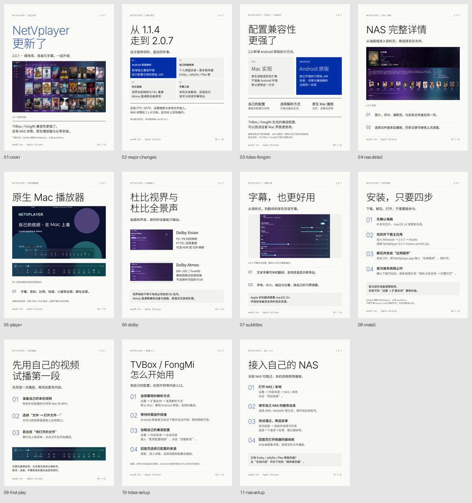

# NetVplayer 小红书宣传稿与新手图文

当前版本为 **2.0.7／build 58 正式版**，发行依据核对于 **2026-11-20**，本稿修订于 **2026-11-21**。现行稿使用用户指定的**归藏 Swiss International／IKB 蓝白风格**：细字、直线分隔和保持比例的真实截图。封面以“NetVplayer 更新了”和真实首页呈现，围绕重大变化、实际界面和首次使用展开，TVBox／FongMi 兼容性作为其中一项能力，可独立阅读。

- [可复制的标题与正文](copy.md)：标题 13 字，正文含空白和 8 个候选话题共 981 字。
- [1.1.4 以来的重大变化](changes-from-1.1.4.md)：按功能归纳，不逐版罗列补丁。
- [新手安装与首次使用](getting-started.md)：GitHub 搜索名称、作者、发行页路线、包名、首次打开、本机试播、自己的兼容配置及 NAS 接入。

## 配图与使用

共 **11 张 1080 × 1440（3:4）PNG**，按编号选图，第 1 张为封面。截图来自实际运行的 **2.0.7／58**；其余为明确的说明页，没有伪造配置页面、下载页面或系统弹窗。



| 顺序 | 图片内容 |
| --- | --- |
| 1 | [封面：NetVplayer 更新了与首页实拍](cards/01-cover.png) |
| 2 | [1.1.4 以来的四项重大变化](cards/02-major-changes.png) |
| 3 | [TVBox／FongMi：两种解析方式与原生 Mac 播放](cards/03-tvbox-fongmi.png) |
| 4 | [NAS 完整详情页实拍](cards/04-nas-detail.png) |
| 5 | [播放器实拍与控制栏放大](cards/05-player.png) |
| 6 | [杜比视界与杜比全景声](cards/06-dolby.png) |
| 7 | [字幕翻译、双语与导出](cards/07-subtitles.png) |
| 8 | [新手：下载、解压安装、首次打开](cards/08-install.png) |
| 9 | [新手：第一次本机播放](cards/09-first-play.png) |
| 10 | [新手：接入自己的 TVBox／FongMi 兼容配置](cards/10-tvbox-setup.png) |
| 11 | [新手：连接自己的 NAS 与服务器](cards/11-nas-setup.png) |

播放器使用本轮自制的本机视频，实拍暂停于 00:00:22／00:10:00，输出为 SDR／PCM；放大图是同一截图的控制栏裁切。首页和 NAS 详情于 11 月 21 日重新截图，先确认海报与可见演职员照片加载完成。参照官网本地安全素材的局部高斯模糊效果，NAS 海报／标题用 8 px、演职员用 5 px、简介用 4 px，保留年份、时长、分类、评分、按钮和栏目清楚；首页海报用原图 10 px（对应官网半尺寸图的 5 px）。私人来源与文件名用不透明色块遮挡，不缩采样成像素块。截图制作说明只保留在本文与配方，成图只标版本实拍。所有 PNG 移除元数据。原始截图和演示视频只留在本机临时目录，不进入 Git 或交付图片包。

## 内容依据与表达范围

| 内容 | 依据 |
| --- | --- |
| 当前正式版本、系统／芯片及安装包 | [2.0.7 Release](https://github.com/spudhero/NetVplayer/releases/tag/2.0.7)、[发行说明](../../../releases/2.0.7.md) |
| 1.1.4 已有 NAS 详情、多文件夹、实际文件续播 | [1.1.4 发行说明](../../../releases/1.1.4.md) |
| Android 原版执行、媒体库、音画与字幕重大变化 | [重大变化及原始依据](changes-from-1.1.4.md) |
| 下载、首次启动、本机文件、配置与 NAS 入口 | [应用指南](../../../guide.md)、本轮实际本机操作 |
| 两种来源解析方式 | [Mac 与 Android 方式](../../../../README.md#两种来源解析方式同一套-mac-体验) |
| 杜比视界动态映射、P7 FEL 与 Atmos 直通条件 | [杜比说明](../../../../README.md#杜比视界与杜比全景声) |
| 本机字幕翻译、导出与 macOS 15+ 条件 | [字幕说明](../../../../README.md#音画与字幕按当前设备调整) |
| macOS 首次打开受阻时的处理 | [Apple 官方说明](https://support.apple.com/zh-cn/102445) |

TVBox／FongMi 的配置兼容是项目背景之一，1.1.4 后的重大变化是 Android 原版执行方式；不能把“兼容配置”扩大为所有配置都可用。Mac 与 Android 两种方式切换后重启，不自动互相回退；界面与媒体播放均为原生 Mac。项目独立开发，与 TVBox／FongMi 无官方隶属关系。

用户反馈旧帖曾被提示“版权或资源相关问题”，本轮展示个人媒体管理和自制视频，不提供影视内容、订阅地址、来源 JAR 或账号。按用户要求，封面及安装页以小字标注“GitHub 搜索 NetVplayer，认准 spudhero”；不放完整网址、域名或二维码。正文、新手说明及重大变化这三份交付文稿也不放完整网址，安装页补全 Releases → 2.0.7 → Assets 与准确 ZIP。素材完成不等于平台复审通过。

杜比视界动态映射不等于电视必然收到 Dolby Vision 信号；Atmos 直通需兼容素材、设备及链路，原速且关闭音频处理。本机字幕翻译需 macOS 15+ 与受支持语言资源。设置与自制 SDR 视频截图不作为新杜比硬件验收；代表样本修复不扩大为所有服务或文件都已验证。

## 编辑、复现与交付

[index.html](index.html) 为当前归藏版的可编辑源，从技能的 `assets/template-swiss-card.html` 复制并保留共享色彩、字体和间距 token；本轮只增加作用于 `.nv` 的布局样式。[layout.json](layout.json) 记录页面顺序、配方、原图摘要及脱敏坐标，[images.json](images.json) 记录当前素材和成图摘要。

使用已安装的归藏技能和 Playwright 浏览器，设置 `GUIZANG_SKILL_ROOT` 为技能目录后，从公开 App 仓库根目录运行：

```sh
node "$GUIZANG_SKILL_ROOT/scripts/render.mjs" docs/marketing/xiaohongshu/update-2.0.7-20261120 --out cards --no-embed
```

当前环境复用已安装的 Chrome，没有安装新浏览器。使用 `--no-embed`，Inter／Noto Sans SC／JetBrains Mono 字体需联网加载；成图 PNG 不依赖字体。复现时离线字体嵌入需要技能的完整字体依赖，不能将本轮结果称为已验证的离线重渲染。旧 Pillow 渲染器对应历史版式，不再用于当前 `layout.json`。

已人工查看 11 张成图，并核对尺寸、空 PNG 元数据、文件摘要和 ZIP 条目字节／CRC。用户选择自动核查后，已运行归藏 `validate-social-deck.mjs --style=swiss`：11 页 **0 FAIL／11 WARN**，均为 R5 留白密度提示（56%—74%）；人工复看后保留当前简洁版式。修正一处封面标题间距后，最终检查未报告溢出、页脚碰撞、字号、标题或图框问题。

11 月 21 日版更新封面、兼容说明、NAS 详情和安装页四张图片；其余七张不变。当前 11 图版替代原 8 图版的现行选图顺序；旧稿和旧图的 Git 历史、旧 8 图 ZIP 及原验收记录保留。**11 月 21 日归藏版 ZIP 只含 11 张当前图片、正文、新手说明和重大变化，共 14 项**，避免混入旧图。复制 `copy.md` 中标题、正文即可；平台话题需从候选中选择，普通 `#文字` 不保证成为可点击话题。本目录仅交付素材，尚未向小红书上传或发布。
