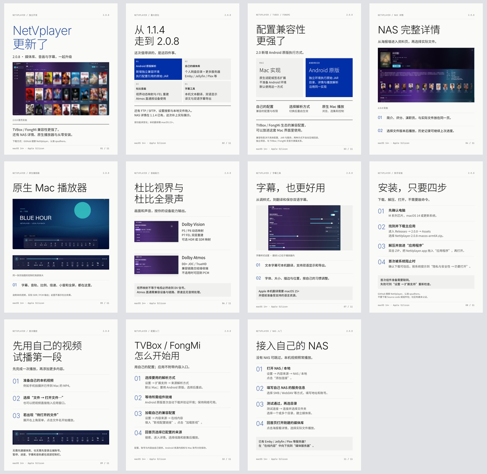

# NetVplayer 2.0.8 小红书图文

从 **1.1.4** 到 **2.0.8（build 59）**，按使用场景回顾四项大变化。正文和图序沿用 11 月 21 日准备的归藏蓝白稿，下载步骤对应 2.0.8 正式版。 [2.0.8 发行说明](../../../releases/2.0.8.md)

[可复制的笔记正文](copy.md) · [新手安装与首次使用](getting-started.md) · [1.1.4 以来的重大变化](changes-from-1.1.4.md)

## 选图顺序

共 11 张 1080 × 1440 PNG。

| 顺序 | 图片 |
| --- | --- |
| 1 | [封面与新版首页](cards/01-cover.png) |
| 2 | [从 1.1.4 到 2.0.8 的四项大变化](cards/02-major-changes.png) |
| 3 | [TVBox／FongMi 兼容与两种解析方式](cards/03-tvbox-fongmi.png) |
| 4 | [NAS 详情与文件版本](cards/04-nas-detail.png) |
| 5 | [原生 Mac 播放器](cards/05-player.png) |
| 6 | [杜比视界与杜比全景声](cards/06-dolby.png) |
| 7 | [字幕翻译、双语显示与导出](cards/07-subtitles.png) |
| 8 | [下载与首次安装](cards/08-install.png) |
| 9 | [首次本机试播](cards/09-first-play.png) |
| 10 | [使用自己的 TVBox／FongMi 兼容配置](cards/10-tvbox-setup.png) |
| 11 | [接入自己的 NAS 与服务器](cards/11-nas-setup.png) |

封面与安装页以小字写明搜索词和项目作者。安装页和新手文稿列出 Releases → 2.0.8 → Assets 与准确的主应用 ZIP 名称。成图与随包文稿都使用文字搜索路径。

## 截图与核查

首页、NAS 详情与播放器采用已有的 2.0.8 正式包实拍。NAS 的海报和人像做局部轻模糊，保留界面标签、评分和操作区域。播放器展示自制本机视频。音画与字幕页沿用 2.0.7 的设置截图，各素材记录实际采集版本。 [素材身份与裁切](layout.json)

归藏自动核查 11 页零失败，11 条提示均为留白密度。已复看成图，核对尺寸、摘要和 ZIP 内容。 [图片摘要与检查结果](images.json)

## 复现

用归藏技能的 `scripts/render.mjs` 渲染本目录，输出参数为 `--out cards --no-embed`。HTML 使用在线字体，交付 PNG 已固定版面。 [排版源](index.html)
